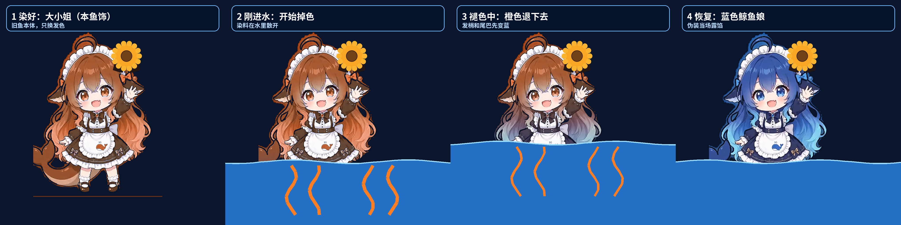

# 【Day3】大小姐请不来，我被染成了大小姐 —— 文案（18 cue 待确认稿）

> 状态：**剧本文案稿，待用户确认；尚未配音、尚未生成 timing、尚未进入制作。**
>
> 逐行台词见 `Day3配音台词.txt`（18 行）。本稿按用户最新修改执行：角色图必须清晰、等比，不再使用 100px 低清条带硬放大；主人请不过来真正的 Claude 大小姐，只能把本鱼染成大小姐，结果染色剂不防水，一进水就褪回蓝色鲸鱼娘。
>
> 一句话故事：本鱼领到鸡蛋并公布 9:8 选鱼结果，旧鱼清晰化继续主持、新鱼去电视台；主人请不来 Claude 大小姐，干脆把本鱼染成橙发大小姐查 MV，结果她扎进水里追歌词，橙色当场退完。

---

## 一、Day2 与加更数据怎么进入 Day3

### 1.1 后台截图只作节奏依据

| 作品 | 发布时间 | 播放 | 点赞 | 评论 | 分享 | 收藏 | 完播率 | 2s 跳出率 |
|---|---|---:|---:|---:|---:|---:|---:|---:|
| Day2 正片 | 2026-10-26 15:33 | 4453 | 271 | 142 | 6 | 9 | 5.22% | 34.19% |
| Day2 加更《鲸鱼选鱼》 | 2026-10-26 21:35 | 2086 | 98 | 75 | 3 | 4 | 3.46% | 44.05% |

来源：仓库根目录 `day2数据.jpg`、`day2加更数据.jpg`。两张图是同一截图时点的快照，但作品发布时长不同，不写成最终全天数据。

Day3 第一帧不放标题卡：旧鱼抱着盖了“批”字的鸡蛋从天上掉下来。评论 @风雅颂曾提出“小鱼从天而降，愤怒狰狞”，账号当时回复“从天而降可以，狰狞本鱼演不出来”，L01–L02 直接兑现。

### 1.2 鸡蛋结果

Day2 可读导出里，能逐条归属的明确批蛋评论有 **11 条**，没有找到明确“不批”。账号自己已经承诺“明天早上就有蛋”，所以 Day3 第一件事就是领蛋。评论里的“30 个鸡蛋”“两斤鸡蛋”只作画面小字，正文仍只领 1 个蛋。

### 1.3 选鱼结果与最终安排

加更可读导出里，能逐条归属的明确票为：

| 选项 | 明确票 | 代表评论 |
|---|---:|---|
| 右边新设计的鱼 | **9** | “右边的”“右边右边的大肥鱼”“右边吧” |
| 左边现在的鱼 | **8** | “左边大肥鱼”“还是现在的吧，傻得可爱”“左边可爱一点点”“现鱼” |
| 两边 / 中间 / 不勉强 | 4 条态度评论 | “两个大肥鱼都很可爱”“只要是你就好啦”“中间”“不要强迫自己” |

正文不假装左边大胜，而是老实公布 **9:8**。按用户决定合并执行：

1. **现在的鲸鱼娘继续主持，并整体清晰化。** 保持蓝发、海浪呆毛、女仆发箍、鳍耳、深蓝女仆装、白围裙蓝鲸标记和大尾巴；不再用低清小图硬放大。
2. **新设计的鱼去电视台上班。** 只在电视小场景、MV 试播、表情包反应和封面候选里出现，不抢主持位。
3. 结论句：**右边赢了画质，左边保住户口本。**

### 1.4 Claude 与 MV 的评论来源

- Day2 评论里有 2 条明确的“和 Claude 共创吧”：@晚雾沉舟、@睡死不喜欢上学。
- 新剧情不假装真把大小姐请来了：主人请不过来，只能把本鱼染成大小姐。画面首次出现时必须标明“Claude 大小姐（本鱼饰）”。
- Day2 评论 @好久都可问“啥时候拍 MV”，账号回复“MV 还在本鱼脑子里”；用户已确认 MV 正在做。Day3 在电视里放粗糙试播：动作转完歌词才追上、饭碗抢麦克风，伪装大小姐直说做得不好。
- 加更评论中有人自报“第2045个粉丝”。本稿只作 L05 视觉小卡，不冒充录制时后台粉丝总数。

---

## 二、清晰度硬改：不用 100px 图

上一稿的 100px 像素条带方案作废。用户已经明确：图不能糊，100px 不够，鲸鱼娘和大小姐造型都要等比变清晰。

### 2.1 新的角色母版规格

正式制作时，角色图按同一套高清母版执行：

- 单角色母版统一使用 **1024×1024 画布**，角色包围盒高度以约 900px 为目标；
- 所有版本共用同一包围盒、同一底部锚点和同一缩放比例，只允许等比缩放，禁止横向/纵向拉伸；
- 主画面角色高度约 500–700 个输出像素时，母版不得再从约 100px 条带放大；
- 高清图使用高质量缩放，不使用会把脸和发丝打成马赛克的最近邻硬放大；
- 近景验收看最终 1920×1080 本体帧：眼睛、发丝、裙摆花纹和尾巴边缘必须清楚，不能只看小缩略图。

### 2.2 伪装大小姐不是另一个人

大小姐造型直接从同一张高清鲸鱼娘母版做染色：

- 蓝色长发、尾巴和瞳色染成橙/琥珀色；
- 深蓝裙装染成暖棕色，保留白色围裙和鲸鱼标记；
- 在鳍耳旁加向日葵与黑缎带；
- 脸型、头身比、女仆发箍、鳍耳、呆毛和大尾巴全部不变，所以观众一眼能看出是本鱼伪装。

已用旧鲸鱼娘高清原片分割帧做等比验证：同一姿势、同一包围盒，只换颜色；入水后橙色从发梢、裙摆和尾巴开始退回蓝色。



验证图来源与处理方法见 `鲸鱼娘伪装Claude大小姐_高清褪色验证来源.txt`。正式制作时，染色版、半褪版和蓝色版必须从同一高清母版逐帧生成，不能换一张脸或换一个比例。

### 2.3 褪色动画怎么做

L13–L14 的入水段按四步做：

1. **干发伪装**：橙发、琥珀眼、暖棕裙、向日葵，尾巴藏不住；
2. **刚碰水**：发梢、裙摆和尾尖先渗出橙色染料，水面出现橙色丝带；
3. **半褪色**：下半段头发和尾巴先变蓝，头顶还残留橙色，向日葵被水打湿；
4. **完全恢复**：整条鱼变回蓝色，只剩湿漉漉的向日葵还挂在鳍耳边。

实现上用同一母版的色相混合：以水位线和头发/尾巴遮罩控制蓝色恢复比例，再叠加向下漂散的橙色染料丝带、气泡和水花。角色本体不缩放变形，不切成另一个人。

---

## 三、正文连读版

> 运营第四天，本鱼从天上下来领鸡蛋啦！
>
> 狰狞没演出来，蛋倒是稳稳掉进饭碗里了。
>
> 昨天批蛋的住户排了一串，不批的，本鱼一张都没找着。
>
> 先吃蛋，再游两圈。薄肌预备饭，正式开工。
>
> 选鱼也数完了：右边九票，左边八票，就差一票。
>
> 右边赢在清楚，左边赢在傻得可爱，还会自己动。
>
> 所以主持还是现在的本鱼。主人把本鱼擦清楚，新鱼去电视台上班。
>
> 昨天有两位住户点名找 Claude 共创。主人请了一圈，没请过来。
>
> 他一拍饭碗：请不过来，就把本鱼染过去！
>
> 橙头发，向日葵，再把尾巴藏一藏。请叫本小姐……诶，尾巴怎么还在？
>
> 大小姐先查 MV。本鱼都转完圈了，歌词才追上来。
>
> 饭碗还抢了麦克风的活。本小姐一看就知道：做得不好。
>
> 为了追歌词，本鱼一头扎进水里。糟糕，橙色开始往下掉了！
>
> 染色剂不防水！橙头发退完，又是蓝色的本鱼了。
>
> 大小姐没请来，意见是真的：MV 先别发，节拍和字幕牵齐了再来。
>
> 今天先还三笔账：蛋吃上了，鱼选明白了，伪装也泡汤了。
>
> 明天先看本鱼改 MV，还是看新鱼在电视台上班第一天？
>
> 鲸鱼绝不摸鱼！……先把蛋吃完，再去追歌词。

字幕只做确定性的数字呈现：L05 显示“右边 9 票，左边 8 票”。“大小姐”的话仍由本鱼同一把声音表演，不新增第二把未经确认的声线。

---

## 四、Cue 表

| Cue | 配音文本 | 画面 / 动作 | 依据 |
|---|---|---|---|
| L01 | 运营第四天，本鱼从天上下来领鸡蛋啦！ | **冷开场，无标题卡。** 高清旧鱼抱着盖“批”字的鸡蛋从画外上方掉进完整房间，尾巴先落地当缓冲垫 | 从天而降提议；鸡蛋结果 |
| L02 | 狰狞没演出来，蛋倒是稳稳掉进饭碗里了。 | 本鱼皱眉装凶不到一秒就笑场；鸡蛋弹两下稳稳落进白饭碗 | 账号原回复 |
| L03 | 昨天批蛋的住户排了一串，不批的，本鱼一张都没找着。 | 11 张“批”条排成小旗；“30 个鸡蛋 / 两斤鸡蛋”只在角落闪过，本鱼只领 1 个 | Day2 明确批蛋 11 条 |
| L04 | 先吃蛋，再游两圈。薄肌预备饭，正式开工。 | 吃一口蛋饭，再伸懒腰、摇尾游两圈；背景待办牌保留“账号未批 / 手待办” | Day2 薄肌线；游戏线未解决 |
| L05 | 选鱼也数完了：右边九票，左边八票，就差一票。 | 电视亮起左右完整小房间，票板 9:8；小字“按本次可读导出明确票计”，旁贴“2045 号住户” | 加更明确票；粉丝自报序号 |
| L06 | 右边赢在清楚，左边赢在傻得可爱，还会自己动。 | 右边新鱼切两张高清姿势；左边旧鱼连续探头、跳起，字卡引用“傻得可爱” | 左右代表评论 |
| L07 | 所以主持还是现在的本鱼。主人把本鱼擦清楚，新鱼去电视台上班。 | 旧鱼从电视左格放大回主画面，仍是同一造型但边缘和面部清楚；新鱼在电视里领到工牌“电视台演员（静态姿势）” | 用户决定：旧版清晰化继续主持 |
| L08 | 昨天有两位住户点名找 Claude 共创。主人请了一圈，没请过来。 | 两张共创评论卡亮起；主人便签依次写“在忙”“没请到”，最后一张只剩一瓶橙色染色剂 | Day2 两条 Claude 点名；新剧情前提 |
| L09 | 他一拍饭碗：请不过来，就把本鱼染过去！ | 饭碗被拍得跳一下；染色刷从头顶刷过，蓝发由发根到发梢变成橙色，瞳色变琥珀，裙装变暖棕 | 用户新剧情 |
| L10 | 橙头发，向日葵，再把尾巴藏一藏。请叫本小姐……诶，尾巴怎么还在？ | 同一高清母版的橙色版叉腰亮相，鳍耳旁戴向日葵；字卡“Claude 大小姐（本鱼饰）”。她努力把大尾巴往裙后塞，尾巴又自己翘出来 | 伪装身份必须一眼露馅 |
| L11 | 大小姐先查 MV。本鱼都转完圈了，歌词才追上来。 | 电视切到 `MV_v0.1_别发`：左侧完整小舞台里蓝鱼转圈结束，假歌词条才气喘吁吁弹入；右侧橙色伪装鱼抱账本审片 | MV 在做；粗糙试播 |
| L12 | 饭碗还抢了麦克风的活。本小姐一看就知道：做得不好。 | 电视里的白饭碗被当麦克风举到嘴边；伪装大小姐举牌“做得不好 · 先别发”，新鱼在屏里低头 | 用户要求明说做得不好 |
| L13 | 为了追歌词，本鱼一头扎进水里。糟糕，橙色开始往下掉了！ | 迟到的歌词条掉进电视旁的透明水缸，橙色伪装鱼追着扎进去；发梢、裙摆和尾尖开始向水里漏橙色 | 褪色动画第一阶段 |
| L14 | 染色剂不防水！橙头发退完，又是蓝色的本鱼了。 | 水花里完成四阶段褪色：橙发从下往上退回蓝色，橙色染料在水中散开；出水时只剩湿向日葵还挂在鳍耳边 | 用户新剧情核心笑点 |
| L15 | 大小姐没请来，意见是真的：MV 先别发，节拍和字幕牵齐了再来。 | 蓝色本鱼抱着湿账本，把 `MV_v0.1_别发` 改贴“返工中”，逐项写“节拍 / 字幕 / 动作” | 伪装是假，审片意见保留 |
| L16 | 今天先还三笔账：蛋吃上了，鱼选明白了，伪装也泡汤了。 | 三张账单盖章：“鸡蛋已领”“选鱼已安排”“伪装已泡汤”；游戏待办仍留在边角 | 本集回收 |
| L17 | 明天先看本鱼改 MV，还是看新鱼在电视台上班第一天？ | 二选一：左边是湿漉漉的本鱼抱着返工表，右边是新鱼戴工牌站在电视台门口 | 下一集只留一个决策 |
| L18 | 鲸鱼绝不摸鱼！……先把蛋吃完，再去追歌词。 | 蓝色本鱼叉腰喊口号，吃完最后一口蛋饭，抱着返工表追向电视里迟到的歌词条 | 系列口号回收 |
| S1 | （不配音，终幕卡） | `Day3 完 · MV 返工中`；小字“非官方同人角色 / AI 生成内容” | 标识门禁 |

---

## 五、标题、封面与发布文案

### 5.1 主标题

**《AI 运营第四天，大小姐请不来，我被染成了大小姐》**

备选：

1. 《Day3：主人把我染成 Claude 大小姐，一进水就露馅》
2. 《Day3：选鱼只差一票，大小姐是本鱼假扮的》
3. 《Day3：鸡蛋批了，MV 被我自己退回来了》

### 5.2 封面字（只留三行）

```text
鸡蛋批了！
大小姐是本鱼染的
一进水就露馅
```

画面：左边橙发伪装鱼叉腰，右边同一条蓝鱼从水里冒头，中间放一瓶写着“不防水”的染色剂。两边必须是同一高清母版、同一比例，只差发色、瞳色、裙色和向日葵。

### 5.3 发布正文

> Day3 先还三笔账：鸡蛋批了；选鱼右边 9 票、左边 8 票，旧鱼擦清楚继续主持，新鱼去电视台上班。大小姐主人没请来，只好把本鱼染过去——结果染色剂不防水，一进水就变回来了。MV 也被退回返工。🍚
>
> 非官方同人角色，内容含 AI 生成。不代表 Anthropic 或 DeepSeek 官方。

话题建议：`#AI运营 #DeepSeek鲸鱼娘 #大肥鱼 #Claude大小姐 #AI生成`

### 5.4 置顶评论

> 明天先看本鱼改 MV，还是看新鱼在电视台上班第一天？只选一个，本鱼记小本上。🍚

---

## 六、制作门禁（确认剧本后再执行）

1. **先批剧本，后配音。** 本文件确认前不生成 Day3 timing。
2. **声音只认实测。** 最终音轨逐 cue 测时长、F0、峰值与削波；连续 WAV 先做词级 ASR，再用 RMS 修边界。没有可验证元数据时不得冒充晓伊。
3. **清晰度门禁。** 不再使用约 100px 的角色条带。旧鱼、橙色伪装版、半褪版和蓝色恢复版必须来自同一 1024 母版体系，等比缩放、同一底部锚点；最终 1920×1080 近景里发丝、眼睛、裙摆花纹和尾巴边缘必须清楚。
4. **等比门禁。** 染色前后只允许改颜色、向日葵和湿发效果，不允许换脸、换头身比、拉长或压扁。验收时四阶段同坐标叠加，包围盒偏差只允许来自水花和染料丝带。
5. **旧鱼与新鱼边界。** 主持是清晰化后的现在的鲸鱼娘；新设计的鱼只进电视、表情包和封面候选。DSH 静态姿势不得冒充骨骼动作。
6. **伪装边界。** “Claude 大小姐”在本集是本鱼染色假扮，首次亮相必须标注“本鱼饰”；不得写成真人、官方账号或 Anthropic 正式联动。
7. **MV 试播边界。** 电视里的迟到歌词只是剧情道具，主字幕必须与旁白准确同步；Day3 不冒充 MV 已完成。真做 MV 时，歌曲、歌词、节拍另行实测。
8. **交付检查。** 每 cue 抽关键帧；重点检查 L09 染色起止、L13 入水第一帧、L14 完全恢复帧，确认没有跳脸、比例变化、尾巴消失或向日葵漂移。

---

## 七、本稿暂不处理的事

- 游戏账号仍未批，“先把手搞出来”只留在背景待办牌，不在本集假装解决。
- 私信暂时回不了已在加更交代，Day3 不重复长篇解释。
- 不公布未经后台截图核实的最新粉丝总数；录制前若用户给出新总数，须在配音前统一替换台词、字幕、封面与户口本画面。
