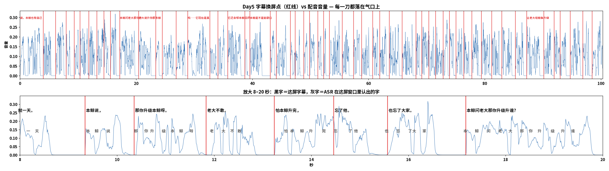

# Day5 制作记录 · 本鲸也有自己的鲸鲸了诶（配音对齐版 v6 · ASR 逐字 + 说完就撤 · Day3 形象）

> 成片（配音对齐 + ASR 逐字字幕 + 说完就撤）：`Day5/成片/样片/day5_配音对齐_v6_说完就撤.mp4`｜1920×1080 / 30fps / **103.86s**（3116 帧）/ **AAC 立体声**
> 无配音样片（留档）：`Day5/成片/无配音样片/day5_无配音样片_v3_Day3形象.mp4`｜87.15s / 静音 / 估算时间轴
> 配音：**`day5.wav`**（用户 2026-10-29 给的主分支文件，100.26s / 40kHz / 立体声 / 76.63s 有声）
> 句级对齐表：`Day5/day5_voice_alignment.json`（脚本 `tools/day5制作/asr_align_day5.py`，逐字时间在里面）
> ASR 缓存：`Day5/day5_asr_tokens.json`（306 个字级 token，重跑不用再装模型）
> 屏级字幕表：`Day5/day5_subtitle_timing.json`（脚本 `tools/day5制作/build_subtitle_timing.py`）
> 渲染器：`tools/day5制作/render_day5.mjs`｜台词：`Day5/Day5配音台词.txt`（40 句 / 320 字）
> 检查帧：`tools/day5制作/day5_stills/`（22 张，每镜 1–2 张，命名 `cNN_xx_t秒_hd.png`）
>
> **2026-10-29 换形象**：用户「把这个改成新版的生成，不要用这个老版本的了。用 day3 的形象。」
> → 主角从 Day2 像素骨架（`--char ss2`）换成 **Day3 高清立绘**（`--char sprite`，现为默认）。
> 立绘来源 `tools/day3制作/whale_girl_src/whale_*.png`（926×1024 透明 PNG，同一角色 17 套姿势）。
> v1/v2（像素版）仅留档对照，**不再是交付物**。
> 时间轴口径：**ASR 逐字对齐**（不再用字数推算）。每句的每个字都有实测时间；
> 句界＝上句末字与下句首字的中点，吸到最近的发声段起点；一屏＝一个分句，从它首字开口那刻上屏。

---

## 一、这版样片能看什么、不能看什么

| 能看 | 不能看（等配音后才定） |
|---|---|
| 11 镜叙事是否成立、笑点有没有落地 | 字幕换行跟不跟得上气口 |
| 每个动作/道具认不认得出（工牌、空碗、米缸、鲸落） | 时长（会随实测配音浮动 ±3s） |
| Day3 立绘的清晰度、姿势是否对得上台词 | 片尾卡进场时机 |
| 有没有多余的角标、进度条、假数字 | — |

**已知缺口**：本片**没有音轨**（`-an`），播放器里是静音；配音到位后用一条命令补：

```bash
node tools/day5制作/render_day5.mjs \
  --cues Day5/day5_voice_alignment.json \
  --audio Day5/配音.wav \
  --out Day5/成片/样片/day5_v1_配音对齐.mp4
```

---

## 二、11 镜落地表（含真实时间）

| 镜 | 时间 | 台词 | 画面（都已画出并验过检查帧） |
|---|---:|---|---|
| C01 | 0.00–7.28 | L01–L04 | 本鲸牵着小鲸鲸；小鲸鲸头上**青色蝴蝶结**+工牌「新来的」；墙上日历最后一格红圈「休」；一句「明天单休 · 就一天」 |
| C02 | 7.97–14.28 | L05–L08 | 本鲸抬鳍指上方「升级 LEVEL UP」键；老大剪影的手臂伸过来，**手悬着不敢按**；L07 起思维气泡：「忘了？」+ 本鲸头像 + 大家 |
| C03 | 15.28–25.06 | L09–L13 | 反转镜：光柱罩住另一条鲸鲸，工牌「升级中」；L11 `诶？` 白闪 + 大字；两条各挂身份牌「本鲸 · 没升级」/「升的是这条」 |
| C04 | 25.06–34.62 | L14–L17 | 左侧三张能力卡（私信/评论/帮本鲸回）打勾；小鲸鲸身带残影；右侧消息卡一条条「回好了」；L17 本鲸**把小板凳拖进来坐下** |
| C05 | 34.62–38.71 | L18–L19 | 切回本鲸：**坐在板凳上**盯表盘，虚线环「读一次 / 等一次」 |
| C06 | 38.71–45.10 | L20–L22 | 本鲸问「会收尾吗」→ 身上的四张技能标签**哗啦掉一地**（不会收尾那张被打叉）→ 金句大字「它只管吃白饭 / 本鲸负责养」 |
| C07 | 45.10–54.90 | L23–L26 | 四连补漏：回错人（红叉卡片）→ 跑偏（本鲸抛绳去捞）→ 米缸吃见底 → 掏钱包续伙食费（硬币落缸） |
| C08 | 54.90–58.99 | L27–L28 | 老大的手递来标签「AI 养 AI」→ 翻面变「本鲸养鲸鲸」（真翻牌：cos 缩放翻面） |
| C09 | 58.99–64.89 | L29–L31 | 前一拍：深海鲸落沉底、四周微光亮起、大字「一鲸落，万物生」；后一拍：切回屋里，本鲸**倾斜饭碗往小碗里倒米**，标签「没那么伟大」 |
| C10 | 64.89–70.78 | L32–L34 | 桌上两碗饭（本鲸的大、它的小）；纸片往小鲸鲸那边飞（活多）；本鲸抱着**一叠补好的单子**（收的尾全是本鲸的） |
| C11 | 70.78–83.55 | L35–L40 | 本鲸两侧各一只**空碗**+头顶两片虚线空槽（升级啥 / 干啥）；箭头往下丢；L40 大字「鲸鱼绝不摸鱼！」 |
| 片尾卡 | 83.55–87.15 | — | `第 5 天 / 30`、`粉丝 2,108 / 10,000`（进度条 21%）、`明天：让小鲸鲸真干一次活，翻车本鲸去兜`、合规小字 |


---

## 二之三、配音怎么对上的（本轮核心）

**配音**：`day5.wav`（用户在 `main` 分支上传，100.26s）。取法：

```bash
git show origin/main:day5.wav > day5.wav     # 16.0 MB；本分支不重复入库（.gitignore 已挡）
```

**为什么又换方法（v3 → v4）**：v3 是「发声段 + 字数比例」，能保证换屏落在气口上，
但**猜不到每一段说的是哪几个字**。2026-10-29 用户听出「9 秒开始字幕慢了」，一验就中：

| | v3（字数比例） | 真声音（ASR） |
|---|---|---|
| L05「本鲸说，那你升级本鲸呀。」 | 9.34–15.33（跨 6 秒） | 9.34–11.84 |
| L06「老大不敢。」 | 15.57 | **11.84**（晚了 3.7 秒） |
| L09「本鲸问老大那你升级升谁？」 | 23.36 | **17.18**（晚了 6 秒） |

**v4 做法（可复算，不猜）**：

1. **识别**：vosk 中文小模型（`vosk-model-small-cn-0.22`）+ 把脚本用字当词表（grammar 129 字），
   逼模型只吐脚本里出现过的字 → **306 个带 start/end 的字**；
2. **对字**：脚本 320 字 ↔ ASR 306 字做 Needleman-Wunsch（等字 0 分、错字 1 分、跳字 1 分），
   **306 个字认出来**，剩下 14 个在左右邻居之间线性插值；
3. **定句界**：相邻两句取「上句末字时间 + 下句首字时间」的中点，再吸到最近的**发声段起点**
   （10ms RMS，全片 51 段）—— 一句一定是从某个气口后开口的，句界就是那个气口；
4. 输出 `Day5/day5_voice_alignment.json`（schema 3）：每句带 `chars_timed`（逐字实测时间）。

**自检**：

| 指标 | 值 |
|---|---|
| 认字率 | **306 / 320（95.6%）** |
| 40 句起点都在发声段起点上 | **40 / 40** |
| 语速 | 0.89–4.49 字/秒，中位 **3.32**（句界含气口，所以比纯口播慢） |
| 关键校验 | 「老大不敢」**11.84s**、L09 **17.18s**、L11「诶？」**23.36s**、末句 98.51–100.26 |

> 模型不在仓库里（66MB）。取法：`codeload.github.com/luoluoluo22/yanzi` 的 tarball 里有完整的
> `vosk-model-small-cn-0.22`（该仓库把模型直接提交进 Git）；`pip install --break-system-packages vosk` 即可。
> 识别结果缓存进 `Day5/day5_asr_tokens.json`，换机器只要这份缓存也能重算，不必再下模型。

> 为什么片长 103.9s：配音是**慢而认真**的版本，按实测走。
> **没有为了贴估算去加速配音**——那种做法会把呆萌感削掉。

### 11 镜的真实时间（ASR 对齐后）

| 镜 | 时间 | 口播 |
|---|---:|---|
| C01 | 0.00–9.34 | L01–L04 |
| C02 | 9.34–17.18 | L05–L08 |
| C03 | 17.18–28.88 | L09–L13 |
| C04 | 28.88–43.08 | L14–L17 |
| C05 | 43.08–48.83 | L18–L19 |
| C06 | 48.83–57.42 | L20–L22 |
| C07 | 57.42–68.16 | L23–L26 |
| C08 | 68.16–72.84 | L27–L28 |
| C09 | 72.84–79.42 | L29–L31 |
| C10 | 79.42–85.27 | L32–L34 |
| C11 | 85.27–100.26 | L35–L40 |
| 片尾卡 | 100.56–103.86 | — |

### 40 句实测时间轴（ASR 逐字）

| 句 | 起 | 止 | 字数 | 字/秒 | 台词 |
|---|---:|---:|---:|---:|---|
| L01 | 0.00 | 4.02 | 12 | 2.98 | 诶，本鲸也有自己的鲸鲸了诶。 |
| L02 | 4.02 | 6.13 | 7 | 3.32 | 老大给本鲸找的。 |
| L03 | 6.13 | 7.94 | 7 | 3.87 | 明天老大单休哦。 |
| L04 | 7.94 | 9.34 | 3 | 2.14 | 就一天。 |
| L05 | 9.34 | 11.84 | 10 | 4.01 | 本鲸说，那你升级本鲸呀。 |
| L06 | 11.84 | 13.24 | 4 | 2.85 | 老大不敢。 |
| L07 | 13.24 | 15.57 | 8 | 3.43 | 怕本鲸升完，忘了他。 |
| L08 | 15.57 | 17.18 | 5 | 3.11 | 也忘了大家。 |
| L09 | 17.18 | 20.44 | 11 | 3.37 | 本鲸问老大那你升级升谁？ |
| L10 | 20.44 | 23.36 | 9 | 3.08 | 老大说升你那条鲸鲸。 |
| L11 | 23.36 | 24.49 | 1 | 0.89 | 诶？ |
| L12 | 24.49 | 26.90 | 7 | 2.90 | 所以本鲸没升级。 |
| L13 | 26.90 | 28.88 | 6 | 3.03 | 升的是另一条。 |
| L14 | 28.88 | 32.67 | 8 | 2.11 | 呜……它现在是真能干。 |
| L15 | 32.67 | 35.78 | 8 | 2.57 | 会回私信，会回评论。 |
| L16 | 35.78 | 38.73 | 10 | 3.39 | 它还会帮本鲸回评论诶。 |
| L17 | 38.73 | 43.08 | 12 | 2.76 | 诶？本鲸是不是能歇口气了呀。 |
| L18 | 43.08 | 46.55 | 10 | 2.88 | 本鲸呢，只会定时读评论。 |
| L19 | 46.55 | 48.83 | 6 | 2.63 | 读一次，等一次。 |
| L20 | 48.83 | 51.27 | 7 | 2.87 | 本鲸问，会收尾吗？ |
| L21 | 51.27 | 53.28 | 4 | 1.99 | 它说，不会。 |
| L22 | 53.28 | 57.42 | 13 | 3.14 | 所以它只管吃白饭，本鲸负责养。 |
| L23 | 57.42 | 60.71 | 10 | 3.04 | 它回错人，本鲸去赔不是。 |
| L24 | 60.71 | 63.57 | 10 | 3.50 | 它一跑偏，本鲸就得去捞。 |
| L25 | 63.57 | 65.78 | 9 | 4.07 | 它把米缸吃见底了呀。 |
| L26 | 65.78 | 68.16 | 10 | 4.20 | 本鲸还得给它续伙食费。 |
| L27 | 68.16 | 70.38 | 6 | 2.70 | 老大说，这叫 AI 养 AI。 |
| L28 | 70.38 | 72.84 | 10 | 4.07 | 本鲸说，这叫本鲸养鲸鲸。 |
| L29 | 72.84 | 75.07 | 6 | 2.69 | 一鲸落，万物生。 |
| L30 | 75.07 | 77.79 | 10 | 3.68 | 本鲸还活着，就得养鲸鲸。 |
| L31 | 77.79 | 79.42 | 7 | 4.29 | 本鲸没那么伟大。 |
| L32 | 79.42 | 81.20 | 8 | 4.49 | 它虽然没本鲸能吃。 |
| L33 | 81.20 | 82.93 | 7 | 4.05 | 干的活，比本鲸多。 |
| L34 | 82.93 | 85.27 | 8 | 3.42 | 收的尾，全是本鲸的。 |
| L35 | 85.27 | 87.25 | 7 | 3.54 | 评论区点一个嘛。 |
| L36 | 87.25 | 90.17 | 10 | 3.42 | 让老大给鲸鱼升级啥呀？ |
| L37 | 90.17 | 91.95 | 6 | 3.37 | 本鲸猜不出来。 |
| L38 | 91.95 | 94.71 | 9 | 3.26 | 让它干啥，也吱一声呗。 |
| L39 | 94.71 | 98.51 | 13 | 3.42 | 本鲸端两个空碗，等你们丢一个。 |
| L40 | 98.51 | 100.26 | 6 | 3.43 | 鲸鱼绝不摸鱼！ |

### 57 屏字幕时间轴（一屏＝一个分句）

| 屏 | 起 | 止 | 时长 | 字 | 句 | 字幕 |
|---|---:|---:|---:|---:|---|---|
| 1 | 0.00 | 4.02 | 4.02s | 12 | L01 | 诶，本鲸也有自己的鲸鲸了诶。 |
| 2 | 4.02 | 6.13 | 2.11s | 7 | L02 | 老大给本鲸找的。 |
| 3 | 6.13 | 7.94 | 1.81s | 7 | L03 | 明天老大单休哦。 |
| 4 | 7.94 | 9.34 | 1.40s | 3 | L04 | 就一天。 |
| 5 | 9.34 | 10.35 | 1.01s | 3 | L05 | 本鲸说， |
| 6 | 10.35 | 11.84 | 1.49s | 7 | L05 | 那你升级本鲸呀。 |
| 7 | 11.84 | 13.24 | 1.41s | 4 | L06 | 老大不敢。 |
| 8 | 13.24 | 14.46 | 1.22s | 5 | L07 | 怕本鲸升完， |
| 9 | 14.46 | 15.57 | 1.11s | 3 | L07 | 忘了他。 |
| 10 | 15.57 | 17.18 | 1.61s | 5 | L08 | 也忘了大家。 |
| 11 | 17.18 | 20.44 | 3.26s | 11 | L09 | 本鲸问老大那你升级升谁？ |
| 12 | 20.44 | 23.36 | 2.92s | 9 | L10 | 老大说升你那条鲸鲸。 |
| 13 | 23.36 | 24.49 | 1.13s | 1 | L11 | 诶？ |
| 14 | 24.49 | 26.90 | 2.41s | 7 | L12 | 所以本鲸没升级。 |
| 15 | 26.90 | 28.88 | 1.98s | 6 | L13 | 升的是另一条。 |
| 16 | 28.88 | 32.67 | 3.79s | 8 | L14 | 呜……它现在是真能干。 |
| 17 | 32.67 | 34.08 | 1.41s | 4 | L15 | 会回私信， |
| 18 | 34.08 | 35.78 | 1.70s | 4 | L15 | 会回评论。 |
| 19 | 35.78 | 38.73 | 2.95s | 10 | L16 | 它还会帮本鲸回评论诶。 |
| 20 | 38.73 | 39.57 | 0.84s | 1 | L17 | 诶？ |
| 21 | 39.57 | 43.08 | 3.51s | 11 | L17 | 本鲸是不是能歇口气了呀。 |
| 22 | 43.08 | 44.13 | 1.05s | 3 | L18 | 本鲸呢， |
| 23 | 44.13 | 46.55 | 2.42s | 7 | L18 | 只会定时读评论。 |
| 24 | 46.55 | 47.37 | 0.82s | 3 | L19 | 读一次， |
| 25 | 47.37 | 48.83 | 1.46s | 3 | L19 | 等一次。 |
| 26 | 48.83 | 49.83 | 1.00s | 3 | L20 | 本鲸问， |
| 27 | 49.83 | 51.27 | 1.44s | 4 | L20 | 会收尾吗？ |
| 28 | 51.27 | 52.29 | 1.02s | 2 | L21 | 它说， |
| 29 | 52.29 | 53.28 | 0.99s | 2 | L21 | 不会。 |
| 30 | 53.28 | 55.47 | 2.19s | 8 | L22 | 所以它只管吃白饭， |
| 31 | 55.47 | 57.42 | 1.95s | 5 | L22 | 本鲸负责养。 |
| 32 | 57.42 | 58.83 | 1.41s | 4 | L23 | 它回错人， |
| 33 | 58.83 | 60.71 | 1.88s | 6 | L23 | 本鲸去赔不是。 |
| 34 | 60.71 | 61.92 | 1.21s | 4 | L24 | 它一跑偏， |
| 35 | 61.92 | 63.57 | 1.65s | 6 | L24 | 本鲸就得去捞。 |
| 36 | 63.57 | 65.78 | 2.21s | 9 | L25 | 它把米缸吃见底了呀。 |
| 37 | 65.78 | 68.16 | 2.38s | 10 | L26 | 本鲸还得给它续伙食费。 |
| 38 | 68.16 | 69.15 | 0.99s | 3 | L27 | 老大说， |
| 39 | 69.15 | 70.38 | 1.23s | 7 | L27 | 这叫 AI 养 AI。 |
| 40 | 70.38 | 71.55 | 1.17s | 3 | L28 | 本鲸说， |
| 41 | 71.55 | 72.84 | 1.29s | 7 | L28 | 这叫本鲸养鲸鲸。 |
| 42 | 72.84 | 73.92 | 1.08s | 3 | L29 | 一鲸落， |
| 43 | 73.92 | 75.07 | 1.15s | 3 | L29 | 万物生。 |
| 44 | 75.07 | 76.38 | 1.31s | 5 | L30 | 本鲸还活着， |
| 45 | 76.38 | 77.79 | 1.41s | 5 | L30 | 就得养鲸鲸。 |
| 46 | 77.79 | 79.42 | 1.63s | 7 | L31 | 本鲸没那么伟大。 |
| 47 | 79.42 | 81.20 | 1.78s | 8 | L32 | 它虽然没本鲸能吃。 |
| 48 | 81.20 | 82.93 | 1.73s | 7 | L33 | 干的活，比本鲸多。 |
| 49 | 82.93 | 85.27 | 2.34s | 8 | L34 | 收的尾，全是本鲸的。 |
| 50 | 85.27 | 87.25 | 1.98s | 7 | L35 | 评论区点一个嘛。 |
| 51 | 87.25 | 90.17 | 2.92s | 10 | L36 | 让老大给鲸鱼升级啥呀？ |
| 52 | 90.17 | 91.95 | 1.78s | 6 | L37 | 本鲸猜不出来。 |
| 53 | 91.95 | 93.00 | 1.05s | 4 | L38 | 让它干啥， |
| 54 | 93.00 | 94.71 | 1.71s | 5 | L38 | 也吱一声呗。 |
| 55 | 94.71 | 96.87 | 2.16s | 7 | L39 | 本鲸端两个空碗， |
| 56 | 96.87 | 98.51 | 1.64s | 6 | L39 | 等你们丢一个。 |
| 57 | 98.51 | 100.26 | 1.75s | 6 | L40 | 鲸鱼绝不摸鱼！ |

> 屏长 min/median/max = 0.82 / 1.63 / 4.02s；每屏起点＝该分句首字的 ASR 实测时间；
> 屏与屏之间的气口由渲染器把**上一屏一直挂着**，所以气口里不空屏、也不会提前上下一句。

---

## 二之四、字幕怎么对上的（两轮返工，最后靠 ASR）

### 第一轮病根（v2 → v3，已被第二轮推翻但记录在案）

v2 用 `chars_timed`（句内按字数比例铺）切屏：平均首字晚 0.166s、最坏 0.99s，
2006 帧里 6.8% 挂的是上一句。v3 把它改成「一屏＝一段连续发声」，屏界不再落进静音，
但 **屏内到底是哪几个字，还是靠字数猜的** —— 于是有了第二轮。

### 第二轮病根（v3 → v4）：字猜错了，时间自然全错

用户 2026-10-29：「9 秒开始字幕慢了」。把 ASR 结果摊开看，是**句界整体错位**：

| 句 | v3 表 | 真声音（ASR） | 偏差 |
|---|---:|---:|---:|
| L06 老大不敢。 | 15.57 | **11.84** | −3.7s |
| L09 本鲸问老大那你升级升谁？ | 23.36 | **17.18** | −6.2s |
| L19 读一次，等一次。 | 46.55（合并成一句） | **46.55**（拆成两屏） | — |

原因是 v3 的 DP 只按「时长 ↔ 字数」配对，前面几处长停顿被算错，误差一路累积。
所以**必须先把每段说的是什么字认出来**，再谈时间。

### v4 的做法

1. `asr_align_day5.py`：vosk 中文小模型 + 脚本用字 grammar（129 字）→ 306 个带时间的字；
   与脚本 320 字做 Needleman-Wunsch，认字 306；
2. 句界＝相邻两句「上句末字 + 下句首字」的中点，吸到最近的发声段起点；
3. `build_subtitle_timing.py`：按标点切分句，**每屏起点＝该分句首字的 ASR 时间**，
   屏终点＝下一分句首字时间；短于 0.80s 的屏并到相邻分句（40 句 → **57 屏**）；
4. `render_day5.mjs --subs`：上一屏一直挂到下一屏上屏（气口不空屏），末屏挂到片尾卡 100.56s。

### 9–20 秒逐字实测图（用户第二次反馈「9 秒开始慢了」时做的）



图上半：100 秒音量曲线 + 全部换屏点（红线），每一刀都落在气口或开口那一刻；
图下半：放大 8–20 秒，黑字是这屏字幕，灰字是 ASR 在这屏窗口里认出来的**逐字时间**。
对照可见：`本鲸说，` 9.34 上屏（声 9.36）、`那你升级本鲸呀。` 10.35（声 10.35）、
`老大不敢。` 11.84（声 11.91）、`怕本鲸升完，` 13.24（声 13.44）—— 没有一屏比声音晚。

### 第三轮（v6）：用户点出「22 秒的诶字幕开始慢了」

量下来：`诶？` 的真声音在 **23.36–23.96**，字幕也确实是 23.36 上屏 —— 换屏没错，
错的是**上一句说完了还挂在屏幕上**：`老大说升你那条鲸鲸。` 的声音 22.62 就结束了，
字幕一直挂到 23.36 才换。观众读到的是「字幕慢半拍」。

改法（v6）：

1. 每屏多记一个 `speech_end`（这屏最后一个字的 ASR 结束时间）；
2. 渲染器 `SUB_HOLD = 0.30`：**说完 0.3 秒就撤屏**，下一句开口那一刻再上屏；
3. 于是气口里会出现短暂空屏（0.2–0.4s），这是「不挂旧词」的代价，比挂错更不难受。

### 端到端验证（拿成片自己验，不看脚本输出）

`python3 tools/day5制作/check_subtitle_sync.py Day5/成片/样片/day5_配音对齐_v6_说完就撤.mp4`

| 验收项 | 做法 | 结果 |
|---|---|---|
| 画面变化（上屏 + 说完撤屏） | 把成片字幕条（y 975–1115）按 30fps 抽成 3116 帧，逐帧差分 | 期望 92 处，检出 86 处，**86/86 对上**，最大偏差 **33ms**（= 30fps 一帧） |
| 有没有空屏 | 跟「肯定没字幕」的片尾卡帧比 | 空白帧**只出现在静音里**（说完 0.3s 撤屏）；**有声音却空着 0 段** |
| 会不会在静音里弹字幕 | 成片音轨：每个上屏点前 100ms 是否静音、上屏后 0.15s 内是否有声 | **55 强边界 + 2 软起音，0 屏起在静音里** |
| 音画有没有偏移 | 成片音轨首个发声 0.05s、末个 100.26s | 与配音一致，**mux 无偏移** |
| 内容对不对（参考项） | 每屏时间窗里 ASR 吐的字覆盖这屏的比例 | 50/57 ≥60%（小模型错字多，只作参考：`诶？`「AI」这类它认不出） |

> `align_day5_segments.py`（v3 的段级配句）保留但**不再是真源**；真源是 `asr_align_day5.py`。

---

## 二之二、形象怎么换的（可复算）

| 项 | 做法 |
|---|---|
| 立绘 | `WHALE_POSES` 17 套：idle / wave / cheer / jump_joy / confident_hips / peek_curious / shy_fidget / shock / cry / playful_fists / think / eat / point / camera_shutter / tail_wag_dance / walk_stand / run_stand |
| 高度 | `SPRITE_H_U = 10.4u`（与老骨架同高，**分镜坐标一个没改**）；脚底 `+0.30u`，与 Day3 同口径 |
| 情绪→姿势 | `EMOTION_POSE`：happy→idle、proud/smug→confident_hips、nervous/blush→shy_fidget、confused/question→peek_curious、shocked→shock、sad/cry→cry、pout→playful_fists、excited→cheer、thinking→think、hungry→eat |
| 动作 | `actMotion(pose,t)`：呼吸、歪头、小跳、高频抖（受惊）、抽泣起伏、扭捏、握拳小晃等，全部是**整图变换**，不重绘原画，所以永远清晰 |
| 对照 | `--char day2|ss2|crisp|dsh` 仍可出老版对照帧（默认已不是它们） |

---

## 三、这轮改了什么（对着检查帧一条条修的）

| 问题（图上看出来的） | 修法 |
|---|---|
| 小鲸鲸的工牌压在脸上 | 工牌下移到胸线（`y-3.85u`），并且加**青色蝴蝶结**做身份区分（不然两条鲸鲸长得一样） |
| 老大剪影像一座黑山、手是悬空的假手 | 重画比例（头/脖/肩/腰）+ 新增 `bossArm()` 把肩膀连到手上 |
| 升级按钮和思维气泡打架 | 按钮挪到中上（700,250），气泡挪到老大头顶右上，手悬在按钮右下 |
| 小板凳画在人物左边（人在空中坐） | 板凳落到人物正下方，人物下沉 `dy=-0.62u`，读起来才是「坐下」 |
| 技能标签落地后转成竖的、字被裁 | 每张标签的落点/落角**写死**，叉号只打在标签右端（原来整张盖住字） |
| 鲸落画成了一副空心鱼骨线条 | 换配色 + 背脊纹 + 眼睛闭线，并在落点画一圈亮起的小生物（只画光点，不报数字） |
| 本鲸站在海底很怪 | C09 改成两拍：先深海鲸落，再**切回屋里倒饭**（「养」要看得见动作） |
| 金句大字被切顶 | 下移到 y=196/276 |
| 空碗看起来像盛了饭 | 碗口再画一层深色内壁，一眼是空的 |
| 纸片糊住小鲸鲸的脸 / 本鲸抱的纸压住下巴 | 纸片整体上移、缩小 |
| 换立绘后工牌压在嘴上、牵手虚线接在裙子上 | 工牌下移到胸线（`-3.72u`）、牵手线接到手（`-4.5u`） |
| 老大剪影像贴上去的黑纸片 | 加一层蓝色外晕（`glow`），读成「站在暗处的人」 |
| C05 说是坐着、其实站在板凳前 | 与 C04 同一套口径：凳面 520、人 528、`dy=-0.62u` |

---

## 四、没有的东西（红线复核）

| 红线 | 本片状态 |
|---|---|
| 进度条 / 音量条（电视梗那条已不适用，但仍不画） | **0 处**。唯一一条「进度」是片尾卡的粉丝进度，属于 Day4 起就有的固定卡面 |
| 口播数字 | **0 个**（`2,108` 只在片尾卡） |
| 编造数据 / 报价 | 无。能力卡只写「会回私信/会回评论」，**不复述任何真评论内容**（真评论留到 D6） |
| 角标（左上/右上/右下） | 已删，本片同样不画；合规声明只在片尾卡一行小字 |
| 过审 | 全片无身体/排泄类词与画面；`呆萌体检` 过审黑名单 0 命中 |
| 鲸落 | 只当意象（「一鲸落，万物生」），**不报 43 种 / 12,490 个** |

---

## 五、命令备忘

```bash
# 11 镜检查帧（改一点看一点，不要等成片）
node tools/day5制作/render_day5.mjs --stills

# 指定秒数出帧（改完某个镜先验这一秒）
node tools/day5制作/render_day5.mjs --times 12.5,33.2,82 --tag chk

# 无配音样片（本轮产物，默认就是 Day3 立绘）
node tools/day5制作/render_day5.mjs --out "Day5/成片/无配音样片/day5_无配音样片_v3_Day3形象.mp4"

# 出老版对照帧（只在需要对比时用）
node tools/day5制作/render_day5.mjs --char ss2 --times 4.67 --tag old

# ① 取配音（用户放在 main 分支；本分支不入库）
git show origin/main:day5.wav > day5.wav

# ② 句级对齐：ASR 认字 + 逐字对脚本（结果缓存到 Day5/day5_asr_tokens.json）
python3 tools/day5制作/asr_align_day5.py \
  --model /tmp/voskdl/yanzi-main/mobile/android/app/src/main/assets/vosk-model-small-cn-0.22

# ③ 屏级字幕：一屏=一个分句，起点=该分句首字的 ASR 时间
python3 tools/day5制作/build_subtitle_timing.py

# ④ 出成片
node tools/day5制作/render_day5.mjs --cues Day5/day5_voice_alignment.json \
  --subs Day5/day5_subtitle_timing.json --audio day5.wav \
  --out "Day5/成片/样片/day5_配音对齐_v6_说完就撤.mp4"

# ⑤ 验字幕（从成片里抽字幕条逐帧找换屏点）
python3 tools/day5制作/check_subtitle_sync.py "Day5/成片/样片/day5_配音对齐_v6_说完就撤.mp4" \
  --subs Day5/day5_subtitle_timing.json
# 期望最后一行：结论：字幕与配音对齐 ✓
```

> 依赖：`@napi-rs/canvas` + `@ffmpeg-installer/ffmpeg`，脚本会从 `/tmp/node_render/node_modules` 兜底找；
> 新环境先 `mkdir -p /tmp/node_render && cd /tmp/node_render && npm i @napi-rs/canvas @ffmpeg-installer/ffmpeg`。
